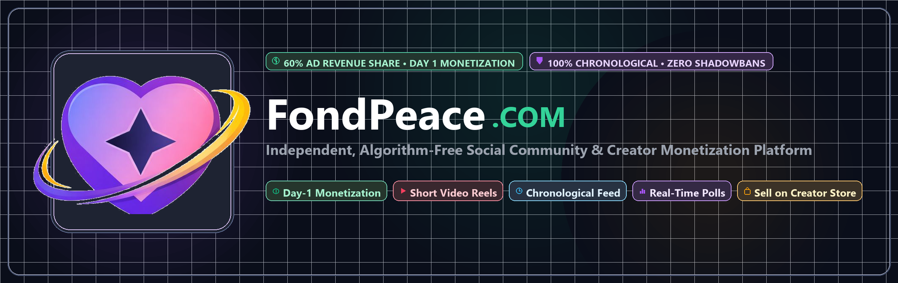
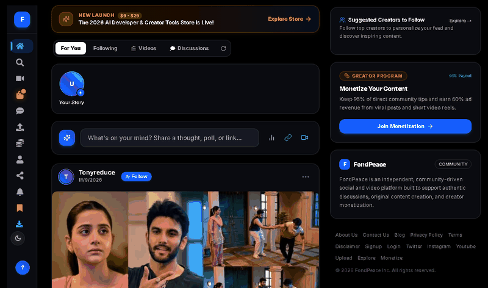
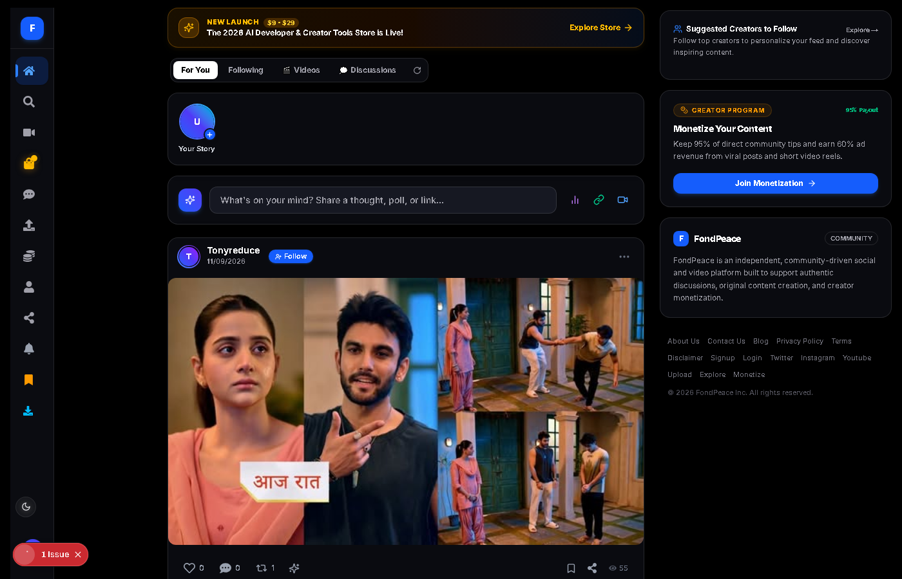
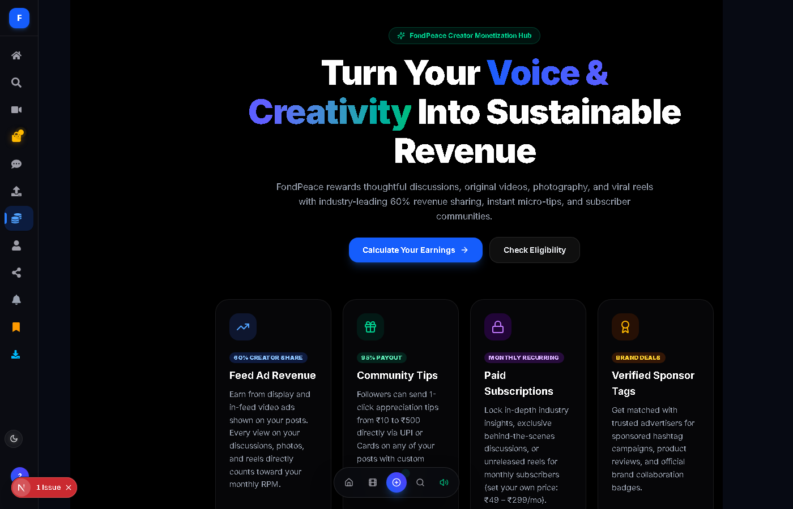
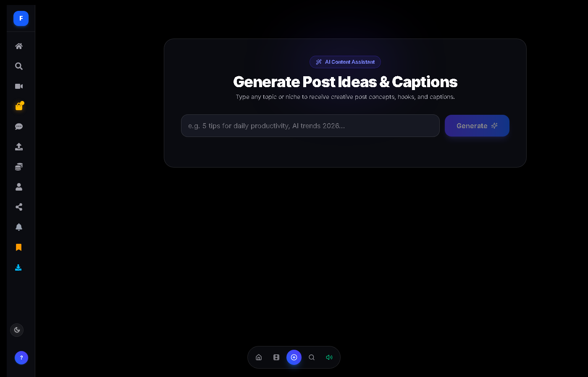
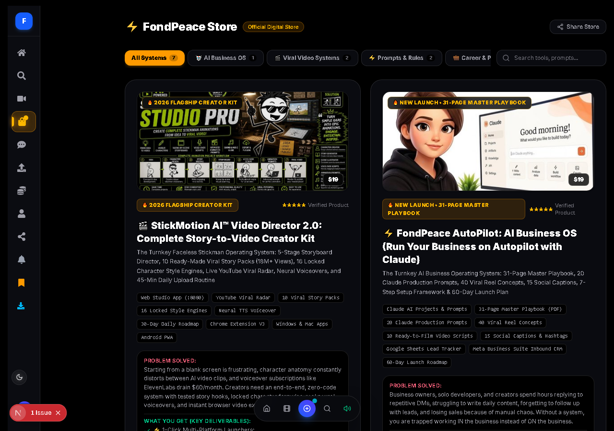
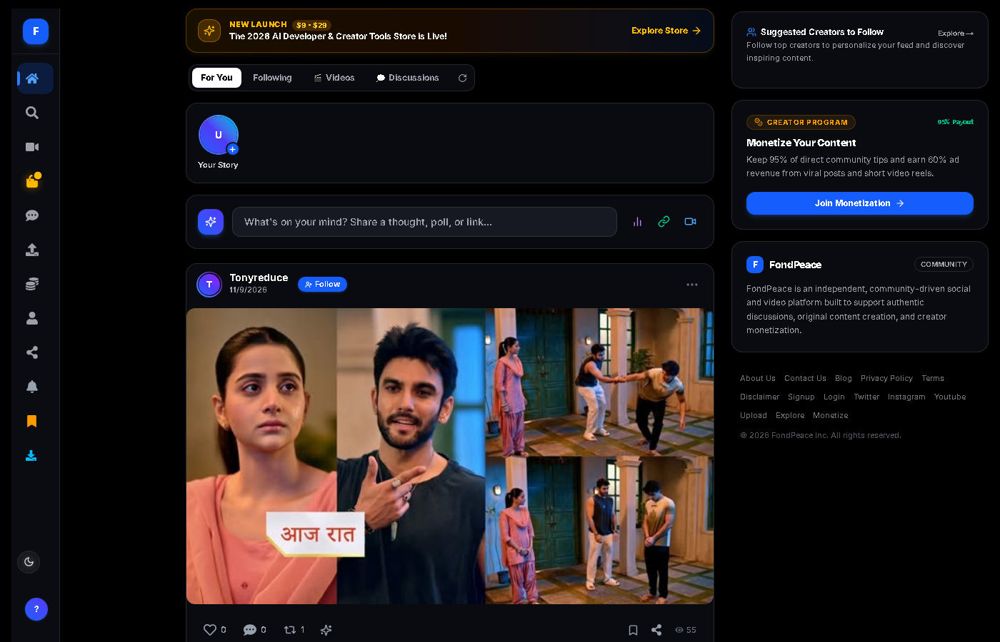

<p align="center">
  
</p>

<h1 align="center">FondPeace.com</h1>

<p align="center">
  <strong>The Independent, Algorithm-Free Social Community &amp; Day-1 Creator Monetization Platform.</strong><br>
  <em>Founded in Noida, India by Aman Kumar. 100% chronological organic reach, 60% direct ad revenue share from day one, 0% commission creator tipping, real-time tamper-proof community polls, and a built-in creator digital store.</em>
</p>

<p align="center">
  <a href="#-live-feed-demo"></a>
  <a href="https://www.fondpeace.com"></a>
  <a href="#-the-creator-earning--monetization-model"></a>
  <a href="#-the-creator-earning--monetization-model"></a>
  <a href="#1--100-chronological-social-feed-zero-shadowbans"></a>
  <a href="#-core-platform-qualities"></a>
  <a href="https://www.fondpeace.com"></a>
</p>

---

## 📱 Live Feed Demo

<p align="center">
  
</p>

<p align="center">
  <em>Real-time, chronological flow of FondPeace: zero algorithms, zero shadowbans, clean multi-media discussions, and instant community interaction.</em>
</p>

---

## 📑 Table of Contents

- [⚡ What is FondPeace?](#-what-is-fondpeace)
- [💎 Core Platform Qualities](#-core-platform-qualities)
- [💰 The Creator Earning & Monetization Model](#-the-creator-earning--monetization-model)
  - [1. 60% Direct Ad Revenue Share (Day 1 Ready)](#1-60-direct-ad-revenue-share-day-1-ready)
  - [2. 1-Click Direct Creator Tips (0% Platform Cut)](#2-1-click-direct-creator-tips-0-platform-cut)
  - [3. Creator Digital Store (/store)](#3-creator-digital-store-store)
  - [4. Monthly Recurring Subscriptions](#4-monthly-recurring-subscriptions)
  - [5. Guaranteed Low-Threshold Payouts (UPI & Global Transfer)](#5-guaranteed-low-threshold-payouts-upi--global-transfer)
- [✨ Visual Platform Walkthrough](#-visual-platform-walkthrough)
  - [1. 📱 100% Chronological Social Feed (Zero Shadowbans)](#1--100-chronological-social-feed-zero-shadowbans)
  - [2. 💵 Day-1 Creator Monetization Engine & Calculator](#2--day-1-creator-monetization-engine--calculator)
  - [3. 🎬 Short Video Reels & Discovery (/shorts)](#3--short-video-reels--discovery-shorts)
  - [4. ✍️ Creator Studio & Upload Suite (/create)](#4--creator-studio--upload-suite-create)
  - [5. 🛍️ Creator Digital Storefront (/store)](#5--creator-digital-storefront-store)
  - [6. 🔍 Neural AI Search & Knowledge Radar](#6--neural-ai-search--knowledge-radar)
- [📊 Comparison: FondPeace vs Big Tech Platforms](#-comparison-fondpeace-vs-big-tech-platforms)
- [🌟 Platform Capability Matrix](#-platform-capability-matrix)
- [👤 Founder & Official Channels](#-founder--official-channels)

---

## ⚡ What is FondPeace?

Mainstream social networks (**YouTube, Instagram, TikTok, X**) have turned content creation into an uphill battle:
- **Opaque algorithms** suppress organic reach to force creators into paying for boosts.
- **Predatory monetization gates** (e.g. 4,000 watch hours, 1,000 subscribers, 10M views) keep 95% of creators from earning anything.
- **Rage-bait feeds** harvest attention for corporate ad revenue while creators receive little to nothing.

**FondPeace.com** is an independent, algorithm-free social community and creator platform founded in **Noida, India, by Aman Kumar**.

FondPeace returns social media to its purest, most rewarding form: **a chronological, transparent ecosystem where every follower sees every post, and every creator earns money from day one.**

---

## 💎 Core Platform Qualities

- **100% Chronological Reach:** No blackbox algorithms. Posts appear in strict chronological order. If someone follows you, they see your content.
- **Zero Shadowbans:** No algorithmic censorship, no artificial throttling, and no pay-to-play visibility traps.
- **Tamper-Proof Community Polls:** Mainstream social polls are broken with fake engagement and manipulated votes. FondPeace provides transparent, real-time polling where every vote is verifiable.
- **Day-1 Creator Monetization:** Earn 60% ad revenue share immediately without arbitrary follower or watch-hour hurdles.
- **0% Commission Tipping:** Direct 1-click tips go directly into creator payouts without platform commission.
- **Calm, High-Value Community:** Designed for real knowledge, technology breakdowns, creative media, and genuine human interaction without toxic rage-bait.
- **Built-in Creator Commerce:** Every user and creator can sell digital tools, software, prompts, and resources right inside `/store`.

---

## 💰 The Creator Earning & Monetization Model

FondPeace is built with a singular focus: **making creator income simple, transparent, and immediate for anyone creating value.**

```
                                      ┌─────────────────────────────────────┐
                                      │   FondPeace Creator Earning Model   │
                                      └──────────────────┬──────────────────┘
                                                         │
             ┌─────────────────────────┬─────────────────┴───────────────┬─────────────────────────┐
             │                         │                                 │                         │
             ▼                         ▼                                 ▼                         ▼
   ┌──────────────────┐      ┌──────────────────┐              ┌──────────────────┐      ┌──────────────────┐
   │  60% Ad Rev      │      │  0% Tip Cut      │              │  Creator Store   │      │  Subscriptions   │
   │  Day 1 Earning   │      │  Direct Tips     │              │  Sell Products   │      │  Monthly MRR     │
   │  ~₹160 / 1k View │      │  Keep 95% Net    │              │  UPI + USD Cards │      │  ₹99 / mo        │
   └──────────────────┘      └──────────────────┘              └──────────────────┘      └──────────────────┘
```

### 1. 60% Direct Ad Revenue Share (Day 1 Ready)
- **Zero Follower or Watch-Hour Traps:** Unlike YouTube (4,000 hours / 1,000 subs) or Meta's restrictive invite programs, FondPeace enables monetization from day one.
- **Industry-Leading 60% Split:** Creators receive **60% of all ad revenue** generated across their posts, articles, community discussions, and video impressions (~₹160 per 1,000 views).
- **All Content Formats Earn:** Whether you post short videos, photography, technical discussions, or community polls, your impressions generate income.

### 2. 1-Click Direct Creator Tips (0% Platform Cut)
- Followers and community members can appreciate your work with instant 1-click micro-tips.
- **0% Platform Commission:** FondPeace takes ₹0 from your tips (creators receive 95% net after standard banking/gateway processing).

### 3. Creator Digital Store (/store)
- Every user and creator can launch their own digital product storefront directly at `fondpeace.com/store`.
- Sell custom software kits, AI prompt vaults, workflow automations, PDF playbooks, and developer tools.
- **Instant Dual-Currency Checkout:** Automated Stripe processing for international buyers in USD ($) + 1-click UPI (Google Pay, PhonePe, Paytm) for Indian users.

### 4. Monthly Recurring Subscriptions
- Launch exclusive memberships, private discussion circles, or premium code walkthroughs at ₹99/month.
- Build reliable monthly recurring revenue (MRR) directly from your most engaged community members.

### 5. Guaranteed Low-Threshold Payouts (UPI & Global Transfer)
- **Low Minimum Threshold:** Withdraw your earnings starting at just **₹500 ($10)**.
- **Punctual Monthly Payouts:** Direct transfers executed automatically on the **10th of every calendar month** via Indian UPI, IMPS/NEFT, or PayPal for international creators.

---

## ✨ Visual Platform Walkthrough

### 1. 📱 100% Chronological Social Feed (Zero Shadowbans)
- Pure chronological timeline with zero algorithmic throttling or engagement bait.
- Every follower sees 100% of your updates in their real order of posting.
- Clean, high-speed multi-media feed supporting rich discussions, code syntax, and real-time community engagement.

<p align="center">
  
</p>

---

### 2. 💵 Day-1 Creator Monetization Engine & Calculator
- Live earnings calculator estimating monthly and annual creator income based on impressions, tips, and memberships.
- Transparent ledger tracking your 60% ad split with real-time performance analytics.
- Simple 24-hour verification workflow to activate instant payouts.

<p align="center">
  
</p>

---

### 3. 🎬 Short Video Reels & Discovery (/shorts)
- Responsive vertical video feed engineered for fast, smooth browsing on desktop and mobile.
- Zero disruptive pre-roll advertisements.
- Direct in-stream creator tipping button for immediate audience appreciation.

<p align="center">
  
</p>

---

### 4. ✍️ Creator Studio & Upload Suite (/create)
- Multi-format publishing engine supporting rich markdown text, high-definition photography, video uploads, and code blocks.
- **Tamper-Proof Community Polls:** Real-time polling with transparent, manipulation-free voter tallying.
- Audience tagging across tech, business, design, and creative topics.

<p align="center">
  
</p>

---

### 5. 🛍️ Creator Digital Storefront (/store)
- Integrated digital marketplace allowing creators to sell their own digital products, guides, and tools to the FondPeace audience.
- Dynamic category navigation, real-time search, and verified customer review showcases.
- Universal checkout with automated USD card processing and Indian UPI.

<p align="center">
  
</p>

---

### 6. 🔍 Neural AI Search & Knowledge Radar
- Lightning-fast semantic search delivering concise, clean knowledge summaries.
- Ad-free, reader-first query results without SEO link farms or sponsored bias.

<p align="center">
  
</p>

---

## 📊 Comparison: FondPeace vs Big Tech Platforms

| Evaluation Metric | YouTube | Instagram / Meta | X (Twitter) | FondPeace.com |
|---|---|---|---|---|
| **Feed Ranking** | Algorithmic watch-time trap | Blackbox pay-to-play algorithm | Blue check boost traps | **100% Pure Chronological** |
| **Follower Reach** | Only ~5%–10% of subscribers | Throttled down to ~3% organic | Heavily throttled without ads | **100% Guaranteed Organic Reach** |
| **Monetization Barrier** | 4,000h watch-time + 1k subs | Strict invite-only / geo gates | Must pay $8/mo + 5M impressions | **Day 1 Ready (Zero Hurdles)** |
| **Ad Revenue Share** | 55% (video only) | 0% (in most countries) | Opaque payout pool | **60% Creator Share (All Formats)** |
| **Direct Tip Cut** | Takes 30% fee (SuperThanks) | Takes 30% fee (Badges) | Takes cuts on subscriptions | **0% Platform Cut (Keep 95% Net)** |
| **Creator Digital Store** | ❌ None (needs 3rd party links)| ❌ Clunky shopping tags | ❌ None | **✅ Built-in Store at `/store`** |
| **Community Polls** | Easily manipulated / botted | Surface-level stickers | Algorithmically skewed | **100% Tamper-Proof & Transparent** |
| **Shadowbans** | Rampant & unexplainable | Routine account suppression | Subjective de-boosting | **Zero Shadowbans Guaranteed** |

---

## 🌟 Platform Capability Matrix

| Platform Module | Capability & Creator Advantage | Access Route |
|---|---|---|
| **Chronological Feed** | 100% organic reach, zero shadowbans, real-time community posts | [`fondpeace.com`](https://www.fondpeace.com) |
| **Monetization Engine** | 60% ad rev share, 0% fee tipping, ₹500 minimum monthly payouts | [`/monetization`](https://www.fondpeace.com/monetization) |
| **Shorts Video Reels** | Vertical high-speed video reels with in-stream tipping | [`/shorts`](https://www.fondpeace.com/shorts) |
| **Creator Studio** | Rich post composer, HD video upload, tamper-proof real polls | [`/create`](https://www.fondpeace.com/create) |
| **Creator Digital Store** | Sell your own software, prompt vaults, guides, and tools | [`/store`](https://www.fondpeace.com/store) |
| **Neural AI Search** | Ad-free semantic search and clean web knowledge radar | Search Bar |

---

## 👤 Founder & Official Channels

**FondPeace.com** was founded in **Noida, India**, by **Aman Kumar**, on the principle that creators deserve transparent reach, reliable monetization, and direct control over their earnings.

- 🌐 **Official Platform:** [fondpeace.com](https://www.fondpeace.com/)
- 🛍️ **Creator Digital Store:** [fondpeace.com/store](https://www.fondpeace.com/store)
- 💵 **Monetization Engine:** [fondpeace.com/monetization](https://www.fondpeace.com/monetization)
- 💼 **Founder LinkedIn:** [Aman Kumar on LinkedIn](https://in.linkedin.com/in/aman-kumar-48a397348)
- 🏢 **Company LinkedIn:** [FondPeace on LinkedIn](https://in.linkedin.com/company/fondpeace)
- 📸 **Instagram Official:** [@fondpeacetecho](https://www.instagram.com/fondpeacetecho/)
- 📘 **Facebook Official:** [FondPeace on Facebook](https://www.facebook.com/61588981728010/videos/why-mainstream-social-polls-are-broken-and-how-fondpeace-fixed-it-mainstream-pol/1682614739967150/)

---

<p align="center">
  <sub>FondPeace.com • Founded by Aman Kumar in Noida, India • Built for creators, developers & independent solopreneurs worldwide.</sub>
</p>
